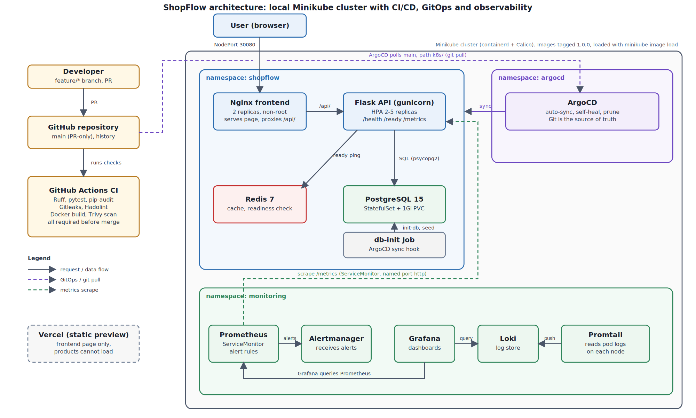

# ShopFlow DevOps Capstone

ShopFlow is a small e-commerce application (Flask API, PostgreSQL, Redis, Nginx frontend) used to practise a full DevOps workflow: containers, CI/CD, Kubernetes, GitOps, monitoring, and security scanning.
The application source was provided by the instructor as a zip (no starter repository). Everything around it is my own engineering work.

## Architecture

    Browser -> Nginx frontend (:8080) --/api/--> Flask backend (gunicorn, :5000) -> PostgreSQL
                                                                      \-> Redis (readiness check)
    GitHub PR -> GitHub Actions (lint, test, audit, scan) -> main -> ArgoCD -> Minikube
    Prometheus scrapes /metrics; Loki + Promtail collect pod logs; Grafana shows both

Track: A (local Minikube). No AWS resources were created, so there is no Terraform, Ansible or cost analysis.

## Technology choices
- **Docker / Compose**: reproducible local stack with healthchecks and a one-shot `db-init` service.
- **GitHub Actions**: every pull request must pass checks before merge.
- **Minikube (containerd, Calico)**: local Kubernetes with NetworkPolicy-capable networking.
- **ArgoCD**: Git is the source of truth for the cluster (automated sync, self-heal, prune).
- **kube-prometheus-stack, Loki + Promtail, Grafana**: metrics, logs and dashboards.
- **Gitleaks, Trivy, pip-audit, Hadolint, Ruff**: security and quality gates.

## Branching strategy
- `main` is protected and always deployable; changes land only through pull requests.
- Work happens on short-lived branches: `feature/*`, `fix/*`, `chore/*`, `docs/*`.
- Every pull request must pass CI (lint, tests, dependency audit, secret scan, Docker build and image scan) before merge.
- Commit messages follow Conventional Commits (`feat:`, `fix:`, `ci:`, `docs:`, `chore:`).
- A merge conflict was created and resolved on purpose (PRs #5 and #6, merge commit `8c3d4aa`).

## Local deployment (Docker Compose)

    cd docker
    cp .env.example .env        # set a password locally; .env is git-ignored
    docker compose up --build -d
    docker compose ps -a
    curl localhost:5000/health
    curl localhost:5000/ready
    curl localhost:8080/api/products

The backend runs as a non-root user (uid 10001) with one gunicorn worker (needed for correct Prometheus metrics). `DATABASE_URL` must use `postgresql+psycopg2://` because SQLAlchemy 2.1 otherwise selects the `psycopg` driver, which is not installed.

## CI/CD
`.github/workflows/ci.yml` runs on every pull request:
1. **Lint and unit tests**: Ruff (pinned, explicit rule set), pytest, pip-audit.
2. **Secret scan**: Gitleaks over the full history.
3. **Docker lint, build and scan**: Hadolint, image builds, Compose validation, Trivy (fails on CRITICAL findings).

Real findings were caught and fixed by this pipeline (see `docs/security.md`).

## Kubernetes
Plain manifests in `k8s/`: ConfigMap, PostgreSQL StatefulSet with a 1Gi PVC, Redis, backend, frontend (NodePort), HorizontalPodAutoscaler (2-5 replicas at 70% CPU), PodDisruptionBudget, ServiceMonitor, Prometheus rules, and a `db-init` Job (an ArgoCD sync hook).
- Backend: liveness on `/health`, readiness on `/ready` (checks PostgreSQL and Redis), resource requests and limits, non-root, no privilege escalation.
- Secrets are never committed. `scripts/create-secrets.sh` creates them with a random password and leaves an existing Secret untouched (so the database password stays valid).
- Images are tagged `1.0.0` and loaded into Minikube (`minikube image load`).
- PostgreSQL is version 15 in Kubernetes and 16 in Compose, because the existing cluster volume holds version 15 data.

## GitOps (ArgoCD)
`k8s/11-argocd-app.yaml` defines an Application that syncs the `k8s/` folder from `main` with `prune` and `selfHeal` enabled. A change to a managed resource made by hand is reverted to match Git. Evidence screenshots are in `evidence/`.

## Monitoring and logging
Prometheus, Alertmanager and Grafana come from kube-prometheus-stack; Loki and Promtail collect pod logs. The backend exposes Prometheus metrics at `/metrics`, and a ServiceMonitor targets the backend Service's named `http` port. Alert rules are in `k8s/10-prometheus-rules.yaml`. The Loki data source is in `monitoring/loki-datasource.yaml`.
Known limitation: I did not finish verifying application metrics end to end in Grafana, and I did not build an application dashboard.

## Security controls
- Non-root containers, dropped capabilities, no privilege escalation.
- Gitleaks (full history), pip-audit, Hadolint and Trivy in CI. Trivy is pinned to a release tag.
- No credentials in Git; Secrets are generated at deploy time.
- Findings and decisions are recorded in `docs/security.md`. Known application weaknesses I identified but did not change (the application source is the instructor's): CORS is open to all origins, there is a default database credential in code, `POST /api/products` has no authentication, and stock decrement has a race condition.

## SLIs, SLOs and error budget
- **Availability SLI**: share of requests that are not 5xx. **SLO**: 99.5% over 30 days, an error budget of 216 minutes (0.5% of requests).
- **Latency SLI**: share of requests faster than 500 ms. **SLO**: 95% over 30 days.
- If more than half of the budget is spent, feature work pauses in favour of reliability.

## Incident response
- Severity: SEV1 (outage or data loss, respond immediately), SEV2 (major degradation, 30 minutes), SEV3 (minor, next working day).
- Steps: detect, acknowledge, assess, mitigate (roll back first), communicate, resolve, blameless review.
- Example: `/ready` returns 503 when Redis or PostgreSQL is down. Kubernetes removes the pod from the Service but does not restart it, because `/health` stays 200. Check `kubectl -n shopflow get endpoints backend` and the pod logs.

## Rollback
Revert the pull request that introduced the change (`git revert -m 1 <merge-commit>`), merge the revert, and ArgoCD syncs the cluster back. Deployments use rolling updates, so a pod that fails its readiness probe does not receive traffic.

## Not completed
Being honest about the gaps: blue-green or canary deployment, scripted failure tests with incident write-ups, an application Grafana dashboard, branch protection evidence, and the Track B AWS work (Terraform, Ansible, cost report). The Vercel link serves only the static frontend, so the product list cannot load there because the backend runs on Minikube.

## Lessons learned
See `docs/lessons-learned.md` for the real problems encountered and how each was fixed.
